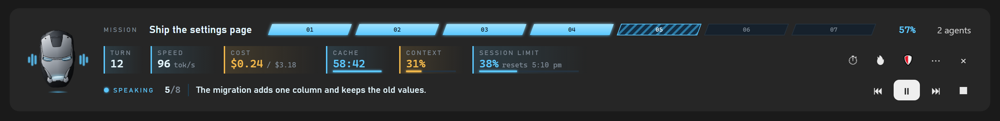

# mods

Mods for [Claude Code](https://claude.com/claude-code): plugins that change how Claude Code looks and behaves. Each folder is one self-contained plugin.

| Mod | What it does |
| --- | --- |
| [Mk2-HUD](mk2-hud/) | A heads-up display above the prompt. It reads Claude's replies aloud in a local neural voice, shows the plan as it progresses, and keeps turn, speed, cost, prompt cache and context in view. |



## Install

In Claude Code, add this repo as a marketplace once, then install the mods you want:

```
/plugin marketplace add SimsonCorreya/mods
/plugin install mk2-hud@mods
```

Or from a terminal:

```bash
claude plugin marketplace add SimsonCorreya/mods
claude plugin install mk2-hud@mods
```

In the desktop app: click **+** next to the prompt box, then **Plugins**, **Add marketplace** with `SimsonCorreya/mods`, then **Add plugin**.

Some mods need extra tools. Mk2-HUD needs [uv](https://docs.astral.sh/uv/getting-started/installation/) and a Piper voice; see [its README](mk2-hud/README.md#install). To pick up new mods and updates later, run `/plugin marketplace update mods`.

## Adding a mod

1. Put the plugin in its own folder, with its `.claude-plugin/plugin.json`.
2. Add an entry to `.claude-plugin/marketplace.json`:
   ```json
   { "name": "my-mod", "source": "./my-mod", "description": "One line on what it does.", "version": "1.0.0" }
   ```
3. Add a row to the table above.
4. Bump a mod's `version` in both `plugin.json` and `marketplace.json` when you change it, so installed copies update.

## License

[MIT](LICENSE), copyright Simson Correya. Each mod has its own license file, which also credits any third-party code it includes.
